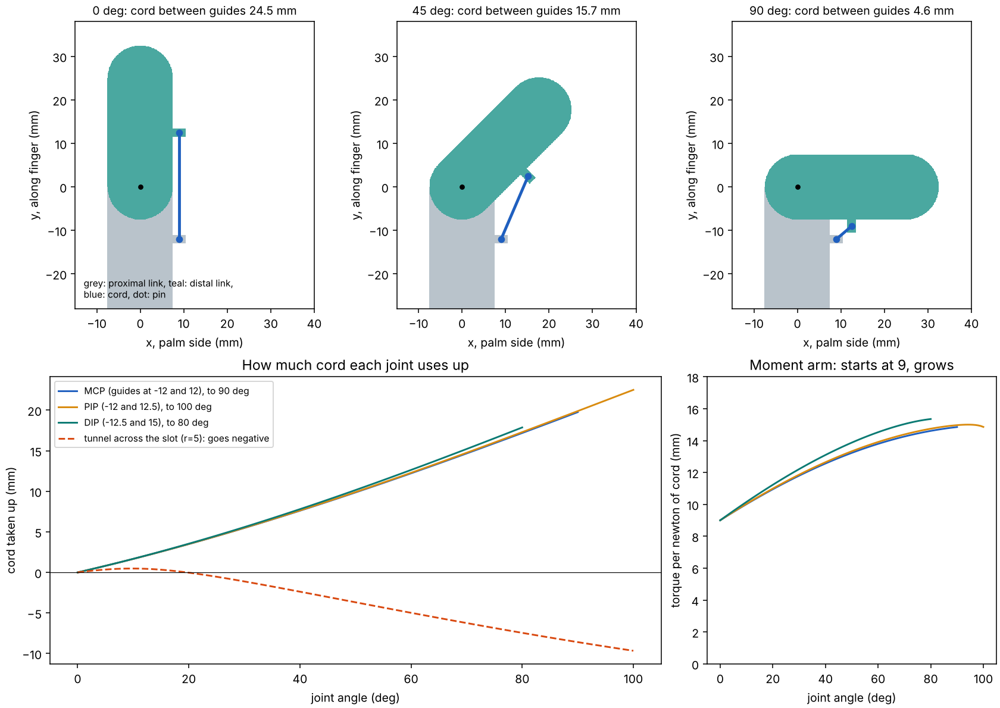
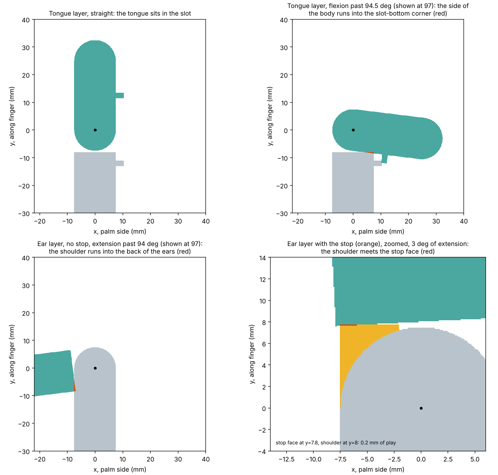
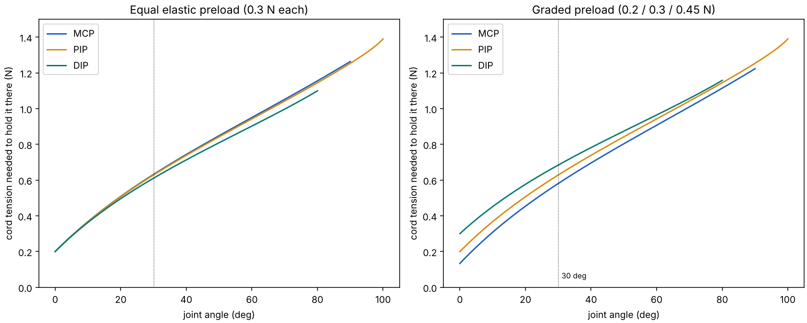

# Calcs

Three small scripts check the finger geometry before anything gets printed. Run them from the repo root. `figures.py` redraws the pictures below from the same code, so they stay in step with the maths.

    python3 docs/calcs/tendon_path.py
    python3 docs/calcs/joint_range.py
    python3 docs/calcs/closing_order.py
    python3 docs/calcs/figures.py

Needs numpy and matplotlib.

## tendon_path.py: cord length and moment arm

The top row is one joint at 0, 45 and 90 degrees. The cord is a straight line between a guide on each link, 9 mm off the pin axis. As the joint closes, that line gets shorter (24.5 mm, then 15.7, then 4.6), and the actuator has to reel in the difference.

The bottom left is that shortening against angle for the three joints. The red dashed line is the first idea, a tunnel through the slot, where the cord gets longer as the joint closes, so it fought the bend.

The bottom right is the moment arm, which is how much torque each newton of cord makes. It's the slope of the bottom-left curves (tension times cord pulled equals torque times angle), so it starts at the 9 mm guide height and grows to about 15 mm.

The 60 mm total in requirements.md is the sum of the three joints at their full angles.

## joint_range.py: where the plastic touches

The ears and the tongue sit at different heights across the 17 mm width, so the script checks two slices. Grey is the proximal link, teal is the distal link, red is overlap.

Top left is the straight joint in the tongue slice. Top right is flexion just past its limit: the side of the body meets the slot-bottom corner. For a slot depth d the limit is 2 * atan(d / 7.5), which is 93.6 degrees for 8 mm (the sweep finds 94.5).

Bottom left is the same joint in the ear slice, bending backwards with no stop. The shoulder swings round into the back of the ears at about 94 degrees. Bottom right is the fix, zoomed in: the orange block is the stop, and the shoulder meets its face a couple of degrees past straight. The sweep says 2.5 degrees, a hand calculation says about 1.6. The grid is 0.1 mm and the angle steps are 0.5 degrees, so read it as a couple of degrees.

The pictures show 97 degrees for the two limits so the overlap is big enough to see.

## closing_order.py: which joint moves first

Each curve is the cord tension needed to hold that joint at an angle against its elastic. The elastic is a straight spring with a preload, and the cord gets more leverage as the joint closes (the moment arm above). Tension rises from zero, so the joint whose curve starts lowest moves first.

On the left all three joints have the same elastic and the curves sit on top of each other, so there's no real order. On the right the knuckle has the lightest elastic and the tip the heaviest, and the knuckle goes first. The gap is small (0.58 N against 0.68 N at 30 degrees), and guide friction could close it. The elastic stiffness is a guess until the cord test.
